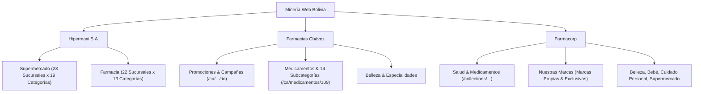

# Catálogo Técnico Maestro de Rutas, Sucursales y Metodología de Histórico de Precios
## Hipermaxi, Farmacias Chávez y Farmacorp (Minería Web Bolivia)

> **Módulo:** Minería de Contenido y Estructura Web (`ws-dm`)  
> **Fecha:** 15 de Noviembre, 2026  
> **Objetivo:** Documentar exhaustivamente la topología de URLs, parámetros de consulta, paginación dinámica, descubrimiento total y trazabilidad temporal de precios en las cadenas comerciales líderes de Bolivia.

---

## 1. Topología de Red y Enlaces por Cadena Comercial



---

### 1.1. Hipermaxi S.A. (`https://www.hipermaxi.com`)

* **Tecnología Frontend:** Next.js SPA con SSR + Radware Bot Manager (*ShieldSquare*).
* **Patrón de Ruta de Sucursal:** `https://www.hipermaxi.com/{departamento}/{sucursal-slug}`
* **Patrón de Ruta de Categoría:** `https://www.hipermaxi.com/{departamento}/{sucursal-slug}/categoria/{categoria-slug}`
* **Mecanismo de Carga:** Scroll Infinito Dinámico asistido por el indicador *"Obteniendo más productos"* en tandas de 50 ítems.

#### Matriz de Sucursales de Supermercado (23 Sucursales)

| Departamento | Nombre Ciudad | Slug Sucursal | Flagship | Enlace de Portada |
| :--- | :--- | :--- | :---: | :--- |
| **La Paz** | La Paz | `hipermaxi-calacoto` | ⭐ | `https://www.hipermaxi.com/la-paz/hipermaxi-calacoto` |
| **La Paz** | La Paz | `hipermaxi-achumani` | | `https://www.hipermaxi.com/la-paz/hipermaxi-achumani` |
| **La Paz** | La Paz | `hipermaxi-miraflores` | | `https://www.hipermaxi.com/la-paz/hipermaxi-miraflores` |
| **La Paz** | La Paz | `hipermaxi-sopocachi` | | `https://www.hipermaxi.com/la-paz/hipermaxi-sopocachi` |
| **La Paz** | La Paz | `hipermaxi-los-pinos` | | `https://www.hipermaxi.com/la-paz/hipermaxi-los-pinos` |
| **La Paz** | La Paz | `hipermaxi-el-poeta` | | `https://www.hipermaxi.com/la-paz/hipermaxi-el-poeta` |
| **La Paz** | La Paz | `hipermaxi-megacenter` | | `https://www.hipermaxi.com/la-paz/hipermaxi-megacenter` |
| **La Paz** | La Paz | `hipermaxi-obrajes` | | `https://www.hipermaxi.com/la-paz/hipermaxi-obrajes` |
| **La Paz** | El Alto | `hipermaxi-satelite` | | `https://www.hipermaxi.com/la-paz/hipermaxi-satelite` |
| **La Paz** | La Paz | `hipermaxi-costanera` | | `https://www.hipermaxi.com/la-paz/hipermaxi-costanera` |
| **La Paz** | La Paz | `hipermaxi-cota-cota` | | `https://www.hipermaxi.com/la-paz/hipermaxi-cota-cota` |
| **La Paz** | La Paz | `hipermaxi-renacer` | | `https://www.hipermaxi.com/la-paz/hipermaxi-renacer` |
| **Santa Cruz** | Santa Cruz | `hipermaxi-canoto` | ⭐ | `https://www.hipermaxi.com/santa-cruz/hipermaxi-canoto` |
| **Santa Cruz** | Santa Cruz | `hipermaxi-equipetrol` | | `https://www.hipermaxi.com/santa-cruz/hipermaxi-equipetrol` |
| **Santa Cruz** | Santa Cruz | `hipermaxi-mutualista` | | `https://www.hipermaxi.com/santa-cruz/hipermaxi-mutualista` |
| **Santa Cruz** | Santa Cruz | `hipermaxi-3-pasos-al-frente` | | `https://www.hipermaxi.com/santa-cruz/hipermaxi-3-pasos-al-frente` |
| **Santa Cruz** | Santa Cruz | `hipermaxi-roca-y-coronado` | | `https://www.hipermaxi.com/santa-cruz/hipermaxi-roca-y-coronado` |
| **Santa Cruz** | Santa Cruz | `hipermaxi-blacutt` | | `https://www.hipermaxi.com/santa-cruz/hipermaxi-blacutt` |
| **Santa Cruz** | Santa Cruz | `hipermaxi-las-palmas` | | `https://www.hipermaxi.com/santa-cruz/hipermaxi-las-palmas` |
| **Santa Cruz** | Santa Cruz | `hipermaxi-cambodromo` | | `https://www.hipermaxi.com/santa-cruz/hipermaxi-cambodromo` |
| **Santa Cruz** | Santa Cruz | `hipermaxi-supercenter` | | `https://www.hipermaxi.com/santa-cruz/hipermaxi-supercenter` |
| **Santa Cruz** | Santa Cruz | `hipermaxi-las-brisas` | | `https://www.hipermaxi.com/santa-cruz/hipermaxi-las-brisas` |
| **Santa Cruz** | Santa Cruz | `hipermaxi-mi-barrio` | | `https://www.hipermaxi.com/santa-cruz/hipermaxi-mi-barrio` |
| **Cochabamba** | Cochabamba | `hipermaxi-blanco-galindo` | ⭐ | `https://www.hipermaxi.com/cochabamba/hipermaxi-blanco-galindo` |
| **Cochabamba** | Cochabamba | `hipermaxi-juan-de-la-rosa` | | `https://www.hipermaxi.com/cochabamba/hipermaxi-juan-de-la-rosa` |
| **Cochabamba** | Sacaba | `hipermaxi-sacaba` | | `https://www.hipermaxi.com/cochabamba/hipermaxi-sacaba` |
| **Cochabamba** | Cochabamba | `hipermaxi-circunvalacion` | | `https://www.hipermaxi.com/cochabamba/hipermaxi-circunvalacion` |
| **Cochabamba** | Cochabamba | `hipermaxi-panamericana` | | `https://www.hipermaxi.com/cochabamba/hipermaxi-panamericana` |
| **Cochabamba** | Cochabamba | `hipermaxi-beijin` | | `https://www.hipermaxi.com/cochabamba/hipermaxi-beijin` |

* **19 Categorías Oficiales de Supermercado (437 combinaciones):**
  `abarrotes`, `bebidas`, `carnes`, `congelados`, `fiambres`, `lacteos-y-derivados`, `panaderia`, `pasteleria-y-masas-tipicas`, `cuidado-del-bebe`, `cuidado-del-hogar`, `cuidado-personal`, `bazar`, `bazar-importacion`, `importaciones-textil`, `jugueteria`, `jugueteria-importacion`, `textiles-y-zapatos`, `frutas-y-verduras`, `granos-y-hortalizas`.

#### Matriz de Sucursales de Farmacia Hipermaxi (22 Sucursales)

* **La Paz (10):** `farmacia-calacoto` (Flagship), `farmacia-achumani`, `farmacia-satelite`, `farmacia-obrajes`, `farmacia-los-pinos`, `farmacia-costanera`, `farmacia-sopocachi`, `farmacia-cota-cota`, `farmacia-renacer`, `farmacia-megacenter`.
* **Santa Cruz (7):** `farmacia-pampa-de-la-isla` (Flagship), `farmacia-villa-1ro-de-mayo`, `farmacia-centenario`, `farmacia-mi-barrio`, `farmacia-las-palmas`, `farmacia-super-center`, `farmacia-equipetrol`, `farmacia-santos-dumont`.
* **Cochabamba (6):** `farmacia-blanco-galindo` (Flagship), `farmacia-juan-de-la-rosa`, `farmacia-sacaba`, `farmacia-circunvalacion`, `farmacia-panamericana`, `farmacia-beijin`.
* **13 Categorías Oficiales de Farmacia (286 combinaciones):**
  `farmacia-eticos`, `farmacia-galenicos`, `farmacia-genericos`, `farmacia-psicotropicos-y-estupefacientes`, `farmacia-quirurgicos`, `farmacia-venta-libre-otc`, `alimentos`, `bebidas`, `cuidado-del-bebe`, `cuidado-del-hogar`, `cuidado-personal`, `cuidados-otc`, `no-comestible`.

---

### 1.2. Farmacias Chávez (`https://www.farmaciaschavez.com.bo`)

* **Tecnología Frontend:** Next.js + Componentes Ant Design (`rc-menu`, `ant-pagination`) + Backend Instaleap / Wanda.
* **Patrón Canónico de URL:** `https://www.farmaciaschavez.com.bo/ca/{slug-categoria}/{id_categoria}?currentPage={n}`
* **Parámetro Clave de Paginación:** `?currentPage=N`

#### Catálogo de Promociones y Campañas Especiales

| Sección / Campaña | URL Base | Paginación Dinámica Real |
| :--- | :--- | :--- |
| **Black Friday** | `https://www.farmaciaschavez.com.bo/ca/black-friday/119` | `?currentPage=1..6` |
| **Mundo Bebé** | `https://www.farmaciaschavez.com.bo/ca/mundo-bebe/120` | `?currentPage=1..N` |
| **Fluidex** | `https://www.farmaciaschavez.com.bo/ca/fluidex/121` | `?currentPage=1..N` |
| **Beauty Party** | `https://www.farmaciaschavez.com.bo/ca/beauty-party/117` | `?currentPage=1..N` |
| **Lunes de Chávez** | `https://www.farmaciaschavez.com.bo/ca/lunes-de-chavez/118` | `?currentPage=1..N` |
| **Chávez Plus** | `https://www.farmaciaschavez.com.bo/ca/chavez-plus/116` | `?currentPage=1..200+` (~5,000 SKUs) |
| **Canasta del Ahorro y Bienestar** | `https://www.farmaciaschavez.com.bo/ca/canasta-del-ahorro-y-bienestar/113` | `?currentPage=1..N` |
| **Productos Garantizados** | `https://www.farmaciaschavez.com.bo/ca/productos-garantizados/115` | `?currentPage=1..13` |
| **Hecho en Bolivia** | `https://www.farmaciaschavez.com.bo/ca/hecho-en-bolivia/123` | `?currentPage=1..15` |
| **Belleza** | `https://www.farmaciaschavez.com.bo/ca/belleza/102` | `?currentPage=1..19` |

#### Vertical Troncal de Medicamentos (`/ca/medicamentos/109` - ~86 páginas)

Árbol jerárquico de subcategorías médicas (Ant Design Nivel 2):
1. **Alivio Del Dolor**: Analgésicos, AINEs, antipiréticos.
2. **Antiinfecciosos**: Antibióticos, antivirales, antifúngicos.
3. **Antiparasitarios**: Antiparasitarios sistémicos y luminales.
4. **Cardiovascular**: Antihipertensivos, cardioprotectores, estatinas.
5. **Dermatológicos**: Corticoides tópicos, cicatrizantes, regeneradores.
6. **Formadores De Sangre**: Hierro, ácido fólico, antianémicos.
7. **Hormonas**: Corticoides sistémicos, tiroides, anticonceptivos.
8. **Neurología**: Anticonvulsivantes, moduladores del sueño, ansiolíticos.
9. **Oncológicos**: Quimioterápicos, coadyuvantes oncológicos.
10. **Óticos Y Oftálmicos**: Colirios, gotas óticas, lágrimas artificiales.
11. **Salud Digestiva**: Antiácidos, inhibidores de bomba (omeprazol), digestivos, antidiarreicos.
12. **Salud Femenina**: Reguladores hormonales, cuidado íntimo médico.
13. **Sistema Respiratorio Y Alergias**: Antitusivos, broncodilatadores, antihistamínicos.
14. **Urológicos**: Antisépticos urinarios, salud prostática.

---

### 1.3. Farmacorp (`https://farmacorp.com`)

* **Tecnología Frontend:** Shopify Liquid + Tema Empire con navegación AJAX multi-columna.
* **Patrón Canónico de URL:** `https://farmacorp.com/collections/{slug}?page={n}&grid_list=grid-view`
* **Parámetros Clave:**
  - `page=N`: Índice de página (1 a N).
  - `grid_list=grid-view`: **Indispensable** para fijar la presentación en cuadrícula de tarjetas `.productitem`.

#### Catálogo Completo de Colecciones Extraídas del Menú

1. **Ofertas:**
   - `/collections/ofertas`
   - `/collections/beauty-party`
   - `/collections/outlet-on-cuidado` (Cuidado Infantil 70% Off)
   - `/collections/revista-de-ofertas`
2. **Lo Nuevo:** `/collections/lo-nuevo`
3. **Belleza:**
   - `/collections/beauty`
   - `/collections/belleza-facial` (Rostro)
   - `/collections/mirada-perfecta` (Ojos)
   - `/collections/labios-perfectos` (Labios)
   - `/collections/unas` (Manicura)
   - `/collections/skincare-coreano` (Skincare)
   - `/collections/accesorios-beauty` (Accesorios de Belleza)
   - `/collections/coloracion-capilar` (Tintes)
   - `/collections/babyliss` (Electro Belleza)
4. **Cuidado Personal:**
   - `/collections/self-care`
   - `/collections/cuidado-del-cabello` (Cuidado Capilar)
   - `/collections/cuidado-bucal` (Cuidado Bucal)
   - `/collections/cuidado-e-higiene-corporal` (Cuidado e Higiene)
   - `/collections/cuidado-femenino` (Cuidado Femenino)
   - `/collections/cuidado-masculino` (Cuidado Masculino)
   - `/collections/adulto-mayor` (Adulto Mayor)
5. **Mamá y Bebé:**
   - `/collections/mama-bebe`
   - `/collections/cuidados-del-bebe`, `/collections/leches-y-formulas`, `/collections/panales-y-toallas-humedas`, `/collections/mamaderas-chupetes-y-tetinas`, `/collections/accesorios-para-bebe`, `/collections/cuidados-de-la-mama`, `/collections/nutricion-infantil`.
6. **Hogar:**
   - `/collections/hogar`
   - `/collections/detergentes-y-jabones`, `/collections/papel-higienico`, `/collections/lavavajillas-y-desengrasantes`, `/collections/ambientadores-y-desinfectantes`, `/collections/accesorios-de-limpieza`, `/collections/cocina`, `/collections/electro-hogar`, `/collections/mascotas`, `/collections/decoracion-y-otros`, `/collections/libreria`.
7. **Nuestras Marcas (Exclusivas y Propias):**
   - `/collections/nuestras-marcas` (39 páginas)
   - *Belleza y Cosmética:* `/collections/aftersun`, `/collections/astra`, `/collections/batiste-dry`, `/collections/biofemenine`, `/collections/conair`, `/collections/ecotools`, `/collections/geske`, `/collections/i-love`, `/collections/qvs-truyu`, `/collections/real-techniques`, `/collections/scunci`, `/collections/sunpro`.
   - *Infantil:* `/collections/arrurru-naturals`, `/collections/baby-vale`, `/collections/buba`.
   - *Nutrición y Bienestar:* `/collections/advanced-sport-nutrition`, `/collections/atlhetica-nutrition`, `/collections/gnc`, `/collections/live`, `/collections/natures-bounty`.
   - *Salud:* `/collections/amaria`, `/collections/farmacorp`, `/collections/lipoless`, `/collections/trojan`, `/collections/mollis`.
   - *Alimentos:* `/collections/aloe-vera-drink`, `/collections/amarket`.
   - *Cocina y Menaje:* `/collections/brinox`, `/collections/coza`, `/collections/ou`, `/collections/sanremo`.
   - *Decoración:* `/collections/concepts-life`, `/collections/merletto`, `/collections/santini`.
   - *Pet Lovers:* `/collections/conairpet`, `/collections/furacaopet`.
8. **Salud y Medicamentos / Salud y Farmacia:**
   - `/collections/medicamentos`
   - `/collections/medicamentos-y-alivio` (subcolecciones: `/collections/acidez-y-reflujo`, `/collections/alergias`, `/collections/control-intestinal`, `/collections/salud-cutanea`, `/collections/digestion-y-gases`, `/collections/dolor-muscular-y-antiinflamatorios`, `/collections/dolor-y-fiebre`, `/collections/estrenimiento`, `/collections/gripe-y-resfrio`, `/collections/sueno-y-descanso`, `/collections/salud-femenina`, `/collections/tos-y-garganta`).
   - `/collections/medicamentos-bajo-receta`
   - `/collections/salud-sexual`
   - `/collections/alivio-del-dolor-1`, `/collections/primeros-auxilios-1`, `/collections/cuidado-digestivo`, `/collections/cuidado-respiratorio`, `/collections/cuidado-cardiovascular`, `/collections/dispositivos-y-accesorios-medicos`, `/collections/sueros`, `/collections/cuidado-de-los-sentidos`.
9. **Suplementos y Nutrición:**
   - `/collections/vitaminas-suplementos-y-minerales`, `/collections/snacks-saludables`, `/collections/proteinas-y-creatinas`, `/collections/vitaminas-y-suplementos`.
10. **Supermercado:**
    - `/collections/supermercado`
    - `/collections/panaderia-y-horneados`, `/collections/leches`, `/collections/yogurt`, `/collections/cafe-te-y-chocolatadas`, `/collections/cereales-y-avenas`, `/collections/arroz-fideos-y-legumbres`, `/collections/aceites-y-vinagres`, `/collections/mermeladas-y-untables`, `/collections/mantequillas-y-margarinas`, `/collections/sopas-salsas-y-aderezos`, `/collections/azucar-y-edulcorantes`, `/collections/aguas`, `/collections/isotonicos-y-energizantes`, `/collections/gaseosas`, `/collections/jugos`, `/collections/chocolates-chicles-y-golosinas`, `/collections/snacks-y-piqueos`.

---

## 2. Metodología de Descubrimiento Total y Extracción de Paginadores

### 2.1. Farmacias Chávez: Componente Simple Pagination
* **Estructura DOM:** `<ul class="ant-pagination ant-pagination-simple">`
* **Elementos Clave:**
  - Control de retroceso (`<`): `li.ant-pagination-prev`
  - Caja de número actual: `li.ant-pagination-simple-pager input`
  - Total de páginas: `li.ant-pagination-simple-pager` (texto format: `/ 19`)
  - Control de avance (`>`): `li.ant-pagination-next`
* **Código de Extracción:**
  ```javascript
  const pagerText = await page.$eval('.ant-pagination-simple-pager, ul.ant-pagination', el => el.textContent || '').catch(() => '');
  const match = pagerText.match(/\/\s*(\d+)/);
  const totalPages = match ? parseInt(match[1], 10) : 1;
  ```

### 2.2. Farmacorp: Paginador Empire Theme
* **Estructura DOM:** `nav.pagination, .pagination--inner`
* **Elementos Clave:**
  - Lista de números: `1  2  3  ...  39`
  - Botón Siguiente: `.pagination--next a` o `a:has-text("Siguiente")`
* **Parámetro Indispensable:** `?page=${n}&grid_list=grid-view`
* **Aceleración Shopify JSON API:**
  `https://farmacorp.com/collections/{slug}/products.json?limit=250&page={n}`

---

## 3. Metodología para Actualizaciones e Histórico de Precios (Time-Series)

### 3.1. Arquitectura Relacional en Neon PostgreSQL

1. **Tabla Maestra de Productos (`catalogo_productos_master`):**
   Centraliza la ficha única del producto y su enlace canónico para sincronizaciones bajo demanda.
2. **Tabla de Histórico de Observaciones (`precios_historico`):**
   Registra la serie de tiempo con métricas de variación calculadas automáticamente:
   $$\Delta \text{Precio} = \text{Precio}_{\text{actual}} - \text{Precio}_{\text{anterior}}$$
   $$\% \text{Variación} = \left(\frac{\Delta \text{Precio}}{\text{Precio}_{\text{anterior}}}\right) \times 100$$

### 3.2. Actualización Puntual Bajo Demanda (Single-Item Sync)
Para refrescar un producto específico sin ejecutar el scraper masivo:
```powershell
node ws-dm/scripts/price_tracker.mjs --url="https://farmacorp.com/products/paracetamol-500-mg-x-20-comprimidos-inti"
```
1. El script reconoce el dominio (`farmacorp.com`, `farmaciaschavez.com.bo` o `hipermaxi.com`).
2. Realiza una petición rápida directa a la ficha técnica en < 2 segundos.
3. Extrae precio actual, precio anterior y descuento.
4. Inserta o actualiza la observación en `precios_historico` y refresca el catálogo maestro.

