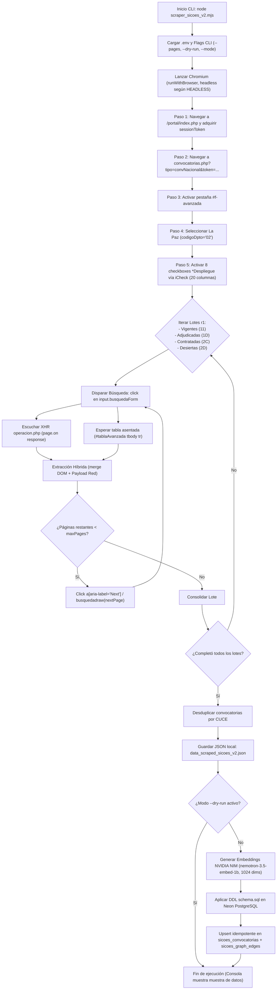

# Documentación Técnica: `scraper_sicoes_v2.mjs`

> **Módulo:** Web Content Mining & Ingesta Vectorial para SICOES La Paz  
> **Ubicación:** `ws-dm/scripts/scraper_sicoes_v2.mjs`  
> **Script Base Arquitectónico:** `ws-dm/scripts/scraper_amz.mjs` (Playwright ESM)  
> **Versión Original Previa:** `ws-dm/scripts/scraper-sicoes.mjs` (v1 HTTP/fetch)  
> **Destino de Datos:** Respaldo JSON (`data_scraped_sicoes_v2.json`) y Neon PostgreSQL (`WS-DM` con extensión `vector(1024)`)

---

## 1. Visión General y Objetivos

`scraper_sicoes_v2.mjs` es un scraper automatizado de última generación diseñado para extraer convocatorias públicas del **Sistema de Contrataciones Estatales de Bolivia (SICOES)** (`www.sicoes.gob.bo`) correspondientes al Departamento de **La Paz (`codigoDpto = 02`)**.

### Principales diferencias con la versión 1:
1. **Navegación e interacción real con Chromium:** En lugar de depender de peticiones HTTP crudas que pueden ser bloqueadas por firewalls de aplicaciones web (WAF) como FortiWeb, utiliza **Playwright** con perfiles reales de usuario y control de ciclo de vida seguro (`try / catch / finally`).
2. **Acceso al formulario avanzado completo (`#formAvanzada`):** Automatiza la apertura de la pestaña avanzada, selecciona La Paz y activa los **8 checkboxes de campos adicionales (`*Despliegue`)** manipulando los controles jQuery/Bootstrap **iCheck**, lo que desbloquea hasta 20 columnas de información pública por licitación.
3. **Paginación real de SICOES:** Integra el botón oficial de paginación `<a href="javascript:void(0);" onclick="busquedadraw('2');" aria-label="Next">Siguiente</a>`, permitiendo recorrer múltiples páginas reales (`--pages=N`) sin recortes artificiales.
4. **Extracción Híbrida (DOM + Red):** Combina la lectura estructurada de celdas HTML mediante `page.$$eval()` con la captura de respuestas JSON asíncronas de `/portal/contrataciones/operacion.php` mediante `page.on('response')`.
5. **Pipeline de Inteligencia Artificial (NVIDIA NIM + pgvector):** Genera representaciones vectoriales densas de 1024 dimensiones para cada objeto de contratación y las sincroniza en Neon PostgreSQL junto con el grafo bipartito de entidades y rubros para análisis de **PageRank** y **HITS**.

---

## 2. Arquitectura de Navegación y Flujo de Ejecución



---

## 3. Algoritmos Clave Implementados

### Algoritmo 1: Gestión de Sesión y Adquisición de Token CSRF
SICOES valida que las consultas provengan de una sesión activa inicializada en el portal principal. El script ejecuta:
1. `page.goto('https://www.sicoes.gob.bo/portal/index.php')`.
2. Extrae el valor del input `#token`.
3. Navega hacia la URL oficial con el parámetro de seguridad:
   `https://www.sicoes.gob.bo/portal/contrataciones/busqueda/convocatorias.php?tipo=convNacional&token=${sessionToken}`.

### Algoritmo 2: Manejo de Checkboxes iCheck y Columnas Desplegadas
En `#formAvanzada`, los 8 campos opcionales tienen inputs con `opacity: 0` envueltos por el plugin jQuery iCheck (`<ins class="iCheck-helper">`). Para garantizar que el formulario serialice correctamente los parámetros en la petición POST a `operacion.php`, el script ejecuta dentro del contexto del navegador:
```javascript
// Activa checkboxes respetando la instancia de iCheck si existe
if (window.jQuery && typeof window.jQuery(el).iCheck === 'function') {
  window.jQuery(el).iCheck('check');
} else {
  el.checked = true;
  el.dispatchEvent(new Event('change', { bubbles: true }));
}
```
Checkboxes activados:
* `personaContDespliegue` (Contacto y Teléfono)
* `nomtoGarDespliegue` (Monto y Tipo de Garantía)
* `costoPlieDespliegue` (Costo de adquisición del pliego)
* `arpcDespliegue` (Autoridad Responsable del Proceso de Contratación)
* `fechaReunionDespliegue` (Reunión de aclaración)
* `fechaAdjudicacionDespliegue` (Fecha de adjudicación)
* `dptoDespliegue` (Departamento convocante)
* `normativaDespliegue` (Normativa aplicable, ej. D.S. 0181)

### Algoritmo 3: Extracción DOM Dinámica (`page.$$eval`)
Lee directamente los elementos `<tr>` de `#tablaAvanzada` analizando los encabezados `<th>` en tiempo de ejecución. Esto permite tolerar cualquier cambio en el orden de las columnas:
* **Archivos adjuntos (`td[9]`):** Extrae los títulos de los documentos oficiales publicados (ej. *"Documento Base de Contratación"*, *"Convocatoria"*).
* **Formularios (`td[10]`):** Identifica formularios oficiales asociados (`FORM 100`, `FORM 110`).
* **Ficha del proceso (`td[11]`):** Extrae el identificador del atributo `onclick="irFicha('/portal/contrataciones/ficha/fichaProceso.php?cp=...')"` y construye la URL absoluta pública oficial.

### Algoritmo 4: Paginación Real SICOES (`busquedadraw`)
La paginación de SICOES no recarga la página completa ni usa clases estándar. Invoca la función global de JavaScript `busquedadraw(nroPagina)` vinculada al control `<a aria-label="Next">Siguiente</a>`.
El script implementa una sincronización por promesas:
```javascript
await Promise.all([
  page.waitForResponse(
    (res) => res.url().includes('/operacion.php') && res.request().method() === 'POST'
  ),
  nextAnchorLocator.click().catch(() => {
    return page.evaluate((p) => window.busquedadraw(String(p)), nextPageNum);
  }),
]);
```
Posteriormente, verifica que la primera celda de la tabla cambie (`waitForFunction`) y que el indicador de carga (`#tablaAvanzada_processing`) desaparezca antes de extraer la siguiente página.

### Algoritmo 5: Interceptación de Red Asíncrona (Algoritmo 3 de `scraper_amz.mjs`)
El script registra un listener `page.on('response', ...)` antes de hacer clic en el botón de búsqueda. Cuando el portal recibe la respuesta AJAX de `operacion.php`, captura el payload JSON original, obteniendo:
* `recordsTotal`: Cantidad total de licitaciones en el historial del Estado boliviano para ese filtro.
* Arreglo crudo de datos indexados por hashes dinámicos de sesión (`colsConvocatoriasAvanzada`).

---

## 4. Estructura de Datos Extraída (20 Atributos)

Cada registro almacenado en `data_scraped_sicoes_v2.json` y sincronizado en Neon PostgreSQL contiene:

| Campo | Tipo | Descripción | Ejemplo |
| :--- | :--- | :--- | :--- |
| `cuce` | `string` | Código Único de Contrataciones Estatales (Clave Primaria) | `"26-1277-00-1708837-1-1"` |
| `entidad` | `string` | Nombre oficial de la institución pública convocante | `"Gobierno Autonomo Municipal De Teoponte"` |
| `tipo_entidad` | `string` | Categoría institucional inferida mediante reglas semánticas | `"Municipio"`, `"Ministerio"`, `"Salud / Caja"` |
| `tipo_contratacion`| `string` | Clasificación legal del objeto de contratación | `"Bienes"`, `"Obras"`, `"Servicios Generales"` |
| `objeto` | `string` | Descripción detallada de los bienes, obras o servicios requeridos | `"Adquisicion De Cemento Y Estuco..."` |
| `modalidad` | `string` | Modalidad de contratación según normativa boliviana | `"ANPE"`, `"CM"`, `"LP"`, `"CND1"`, `"ANPP"` |
| `subasta` | `boolean` | Indica si el proceso contempla puja electrónica | `true` o `false` |
| `departamento` | `string` | Departamento territorial de la convocatoria | `"La Paz"` |
| `fecha_publicacion`| `ISO Date` | Fecha oficial en que se publicó en el portal SICOES | `"2026-11-12T00:00:00Z"` |
| `fecha_presentacion`| `ISO Date` | Fecha límite para que los proponentes presenten sus ofertas | `"2026-11-16T00:00:00Z"` |
| `fecha_adjudicacion`| `ISO Date` | Fecha en la que se resolvió la adjudicación | `"2026-11-20T00:00:00Z"` (o `null`) |
| `estado` | `string` | Estado actual de la licitación | `"VIGENTE"`, `"ADJUDICADA"`, `"CONTRATADA"`, `"DESIERTA"` |
| `formularios` | `string` | Formularios del proceso declarados en la publicación | `"FORM 100"`, `"FORM 110"` |
| `contacto` | `string` | Nombre del funcionario responsable y número de teléfono | `"Edgar Lucio Bustillos Gutierrez (Telf: 71248555)"` |
| `normativa` | `string` | Marco legal bajo el cual se rige la contratación | `"NB-SABS (D.S.0181)"` |
| `pliego_url` | `string` | Enlace permanente oficial hacia la ficha de SICOES | `https://www.sicoes.gob.bo/portal/.../fichaProceso.php?cp=...` |
| `rubro_grafo` | `string` | Área técnica asignada para el análisis de grafos | `"Obras Civiles e Infraestructura"` |
| `archivos` | `string[]` | Lista de nombres de documentos públicos disponibles | `["Documento Base de Contratacion", "Convocatoria"]` |
| `arpc` | `string` | Autoridad Responsable del Proceso de Contratación | `"-"` o Nombre de la autoridad |
| `extraction_source`| `string` | Metadato de auditoría del scraper | `"hybrid"` |

---

## 5. Fronteras Éticas y Política Anti-CAPTCHA

> [!IMPORTANT]
> **Cumplimiento de Integridad:**
> * Las páginas de búsqueda de convocatorias y los resultados tabulares de SICOES son de **acceso público y no están protegidas por CAPTCHA**.
> * Las descargas de archivos PDF (`descargarArchivo.php`) y ciertos modales secundarios están protegidos por **Cloudflare Turnstile** (`challenges.cloudflare.com/turnstile`) y **Google reCAPTCHA**.
> * El script `scraper_sicoes_v2.mjs` **NO intenta resolver, alterar ni evadir ningún CAPTCHA ni prueba de trabajo**. Extrae únicamente la información pública expuesta en la tabla y genera el hipervínculo oficial `pliego_url` para que el usuario humano pueda consultarlo o descargarlo directamente en su propio navegador.
> * Incluye pausas de cortesía (`rateLimitMs = 1500`) entre páginas para no saturar los servidores estatales.

---

## 6. Integración con Neon PostgreSQL y NVIDIA NIM

1. **Vectores de Embedding (NVIDIA NIM):**
   * Emplea el modelo oficial `nvidia/nemotron-3.5-embed-1b` a través de la API en `https://integrate.api.nvidia.com/v1/embeddings`.
   * Procesa el texto concatenado (`${objeto} | ${entidad} | ${tipo_contratacion} | ${modalidad}`) en lotes de 10 registros.
   * Genera vectores normalizados de **1024 dimensiones flotantes**.
   * Dispone de un fallback determinista local en caso de que no se provea `nvidiaApiKey` o falle la conectividad externa.
2. **Carga Idempotente en Base de Datos:**
   * Aplica las sentencias DDL de `ws-dm/db/schema.sql` (creación de extensión `vector`, tabla `sicoes_convocatorias`, tabla `sicoes_graph_edges` e índices HNSW).
   * Ejecuta `INSERT ... ON CONFLICT (cuce) DO UPDATE`, preservando el histórico y actualizando datos que hayan cambiado de estado.
   * Inserta aristas dirigidas en `sicoes_graph_edges` con la relación `(entidad) -[CONVOCA_RUBRO]-> (rubro_grafo)` para el cálculo posterior de PageRank y HITS en el dashboard.

---

## 7. Guía de Ejecución en Consola (PowerShell)

Ubícate en el directorio de la aplicación (`ws-dm`):

```powershell
cd c:\Users\julio\Downloads\INF_2_2026\DM\5.MineriaWeb\ws-dm
```

### Comandos habituales:

#### 1. Extracción de Prueba en Seco (`--dry-run`)
No modifica la base de datos de Neon ni consume créditos de NVIDIA; guarda únicamente el archivo `data_scraped_sicoes_v2.json`:
```powershell
node scripts/scraper_sicoes_v2.mjs --dry-run --pages=1
```

#### 2. Extracción y Sincronización Estándar (2 páginas = 80 registros)
Recorre 2 páginas por cada uno de los 4 estados, genera embeddings con IA y actualiza Neon PostgreSQL:
```powershell
node scripts/scraper_sicoes_v2.mjs --pages=2
```

#### 3. Extracción de Mayor Volumen (5 páginas = 200 registros)
```powershell
node scripts/scraper_sicoes_v2.mjs --pages=5
```

#### 4. Modo Visual Interactivo (Inspección con Chromium abierto)
Permite observar en pantalla cómo Chromium abre SICOES, marca los checkboxes, selecciona La Paz y pagina:
```powershell
$env:HEADLESS="false"; node scripts/scraper_sicoes_v2.mjs --dry-run --pages=2
```

#### 5. Selección de Estrategia de Extracción
* `--mode=hybrid` (Por defecto): Combina DOM y respuestas de red XHR.
* `--mode=dom`: Extrae exclusivamente del HTML renderizado.
* `--mode=network`: Extrae exclusivamente de las respuestas JSON interceptadas.

```powershell
node scripts/scraper_sicoes_v2.mjs --mode=dom --pages=1 --dry-run
```

---

## 8. Mantenimiento y Buenas Prácticas

* **Inmutabilidad de scripts base:** El archivo `scripts/scraper_amz.mjs` permanece como la biblioteca base inmutable de ejemplos de Playwright. Cualquier mejora específica para SICOES debe realizarse exclusivamente dentro de `scripts/scraper_sicoes_v2.mjs`.
* **Credenciales:** Las llaves `NEON_DB` y `nvidiaApiKey` se leen automáticamente del archivo `.env` en la raíz de `ws-dm/`.
* **Control de versiones:** El archivo de salida `data_scraped_sicoes_v2.json` se encuentra ignorado en Git mediante el patrón `data_scraped_*.json` en `.gitignore` para no ensuciar el repositorio con volcados masivos.

